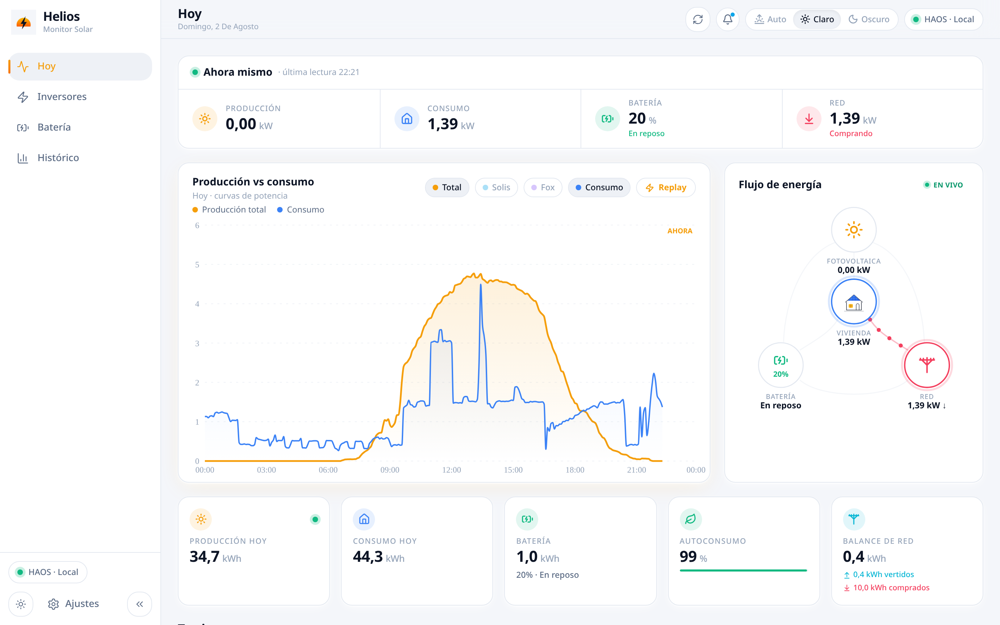
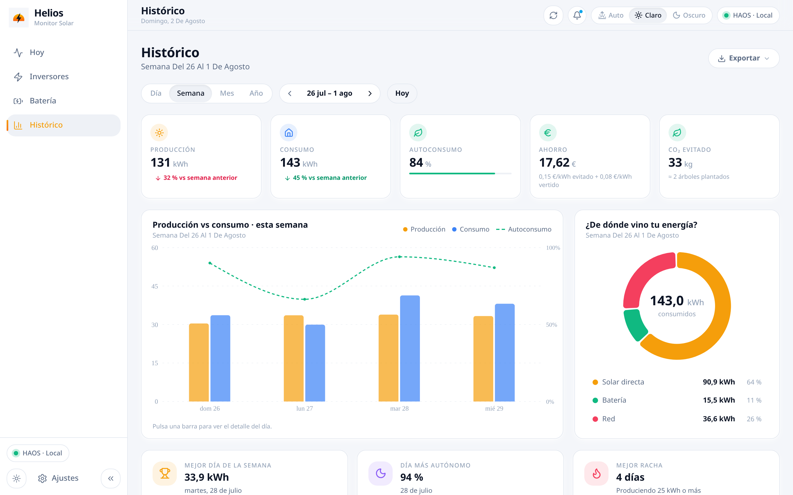
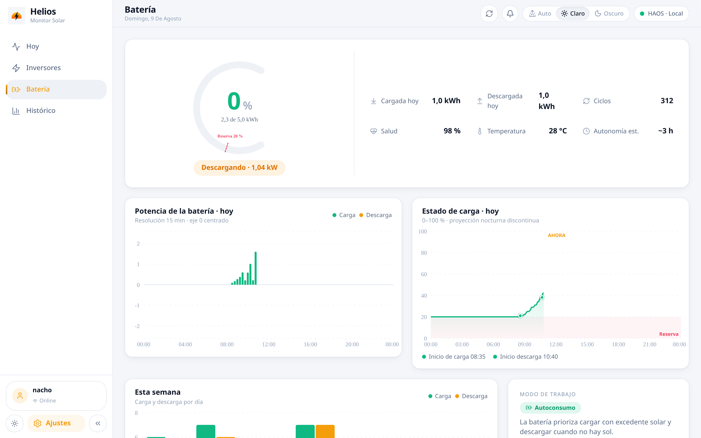

# Helios

<p align="center">
  <a href="README.md">English</a> |
  <a href="README.es.md">Español</a>
</p>

<p align="center">
  <a href="https://helios.cloudless.club"></a>
  <a href="https://demo.helios.cloudless.club"></a>
  <a href="https://github.com/gnacho/helios/releases"></a>
  <a href="https://github.com/gnacho/helios/actions/workflows/release.yml"></a>
  <a href="LICENSE"></a>
  <a href="https://ko-fi.com/gnacho"></a>
</p>

<p align="center">
  <picture>
    <source media="(prefers-color-scheme: dark)" srcset="assets/hero-es-dark.png">
    <source media="(prefers-color-scheme: light)" srcset="assets/hero-es-light.png">
    
  </picture>
</p>

Helios es un monitor solar que alojas tú. Lee los sensores de energía que tu
Home Assistant ya tiene, por su API WebSocket, y los convierte en tres cosas: un
panel en vivo, un histórico largo y el dinero que tu instalación ahorra contra
la tarifa que pagas de verdad.

Un único binario estático de Go con SQLite dentro. No hay cuenta en la nube ni
app del fabricante, y el cliente no descarga un bundle de JavaScript. Tampoco
necesitas Docker.

- **Tus datos se quedan en casa.** La base de datos es un fichero en tu
  máquina, con una réplica continua que controlas tú.
- **Lecturas en vivo.** El panel se mueve con los sensores,
  al ritmo que publique tu integración.
- **Cualquier hardware que Home Assistant vea.** Inversores, batería, contador
  de red, cargadores de coche.
- **Ahorro en euros.** Autoconsumo y ahorro calculados contra
  tu precio real de la luz, no contra una media.

> **Prueba la demo en vivo**
>
> Mírala funcionando sin instalar nada: **[demo.helios.cloudless.club](https://demo.helios.cloudless.club)**.
> Una instalación de ejemplo con datos solares realistas, sin registro y en
> solo lectura.

## Qué hace

**Panel en vivo.** Curvas de producción y consumo, el diagrama de flujo de
energía y los totales del día: lo que hicieron las placas, lo que gastó la casa,
lo que fue a la batería y lo que cruzó el contador. Todo se actualiza por SSE
mientras la página está abierta, y las gráficas se redibujan solas cada minuto
sin recargar.

**Histórico que sobrevive.** Agregados diarios por inversor, por cargador y del
conjunto: producción, consumo, importación y exportación de red, carga y
descarga de batería, ratio de autoconsumo, ahorro y CO₂ evitado. Se navega por
semana, mes o año, y los datos son un fichero SQLite que puedes copiar,
inspeccionar o llevarte a otra máquina cuando quieras.

**Tu batería.** Estado de carga, flujos de carga y descarga, y cuánto de tu día
pasó por ella.

**Cargadores de coche.** Una tarjeta por cargador, con potencia instantánea,
los amperios que hayas elegido y programación. Funciona con wallbox y con
cargadores portátiles que solo aparecen en Home Assistant mientras están
enchufados.

**Multiusuario con roles.** Admin y usuarios normales, cookies httpOnly, bcrypt,
límite de intentos de login y registro de auditoría. La recuperación de admin
está limitada a peticiones desde localhost, a propósito.

**Tres idiomas.** Inglés, español y chino, elegidos por usuario y guardados en
la base de datos.

**Una PWA.** Instalable, con tema claro, oscuro y automático. El automático va
por hora solar, no por el sistema operativo.

## Funciona con cualquier instalación

Helios habla con Home Assistant en lugar de con tu hardware, así que cualquier
cosa que HAOS pueda exponer sirve:

- **Cualquier número de inversores.** Cada uno con su nombre, su potencia pico y
  sus sensores.
- **Cualquier número de cargadores de coche.** Wallbox o portátil, a través de
  un interruptor, un sensor de potencia y un selector de amperaje.
- **Una batería.** Este es el límite actual: la topología describe un solo banco
  de baterías, con sus sensores de potencia y de estado de carga. Soportar
  varias está abierto en [#197](https://github.com/gnacho/helios/issues/197).

Mi instalación, como ejemplo y no como requisito: dos inversores de marcas
distintas, una batería y dos cargadores de coche, el segundo portátil y solo
presente en Home Assistant mientras está enchufado. Nada del código está atado a
esas marcas.

Si un equipo no tiene integración local, un scraper puede alimentar Home
Assistant y Helios lo leerá como cualquier otro sensor. A Helios le da igual de
dónde venga el número, solo le importa que esté en HAOS.

## Capturas

Uso real, de la instalación en producción:

**Histórico: agregados semanales, ahorro y CO₂**

<picture>
  <source media="(prefers-color-scheme: dark)" srcset="assets/screenshot-history-es-dark.png">
  <source media="(prefers-color-scheme: light)" srcset="assets/screenshot-history-es-light.png">
  
</picture>

**Batería: estado de carga y flujos**

<picture>
  <source media="(prefers-color-scheme: dark)" srcset="assets/screenshot-battery-es-dark.png">
  <source media="(prefers-color-scheme: light)" srcset="assets/screenshot-battery-es-light.png">
  
</picture>

No hay dataset de demo detrás: son datos reales, que explican mejor para qué
sirve cada vista.

## Cómo funciona

```
inversores · batería · contador · cargadores
                 │
                 ▼
          Home Assistant  ──WebSocket──▶  Helios (Go)
                 ▲                          │
        scraper opcional                    ▼
        (alimenta HAOS)                 fichero SQLite
                                            │
                                        Litestream
                                            ▼
                                   backup que tú controlas
```

Home Assistant hace la parte difícil: habla con el hardware y mantiene vivas las
conexiones. Helios se suscribe a esas entidades, agrega y sanea las lecturas, y
sirve la API y la interfaz desde el mismo binario.

HTML renderizado en el servidor con un poco de Datastar encima, así que no hay
bundle de cliente que compilar ni invalidar. Todo es un proceso Go junto a su
base de datos.

El razonamiento de cada pieza está en [STACK.md](STACK.md) y
[ARCHITECTURE.md](ARCHITECTURE.md).

## Instalación

Helios necesita un Home Assistant con los sensores de energía ya funcionando, y
un token de acceso de larga duración (Perfil → Seguridad → Tokens de acceso de
larga duración).

```bash
git clone https://github.com/gnacho/helios.git
cd helios
make build            # templ + Tailwind + Go, sin Node
./helios-go           # exporta antes HAOS_URL, HAOS_TOKEN y SESSION_SECRET
```

Luego abre la app y deja que un admin configure la topología desde Ajustes: qué
entidades son tus inversores, tu batería, tu fuente de red y tus cargadores. No
hace falta JSON, aunque la API lo acepta si lo prefieres.

- **Configuración en detalle**, con todas las variables de entorno y el objeto
  de topología completo: [docs/configuration.md](docs/configuration.md).
- **Ponerlo en producción**, unit de systemd, backups, actualizaciones y
  recuperación de admin: [docs/operations.md](docs/operations.md).

## Hoja de ruta

| Fase | Qué | Estado |
|---|---|---|
| 1 | Panel live de solo lectura (producción vs consumo) | Hecho |
| 2 | Backend real, multiusuario, histórico, batería, alertas, PWA, endurecimiento | Hecho (~0.6.x) |
| 3 | Hardware configurable (siempre bajo HAOS) | Hecho (0.7.x) |
| 4 | Multi-instalación: varios HAOS o varios Helios vía API | Próximo |

Detalle en [ROADMAP.md](ROADMAP.md). Varias baterías por instalación está
abierto aparte en [#197](https://github.com/gnacho/helios/issues/197).

## Gracias enormes

Helios no existiría sin [Home Assistant](https://www.home-assistant.io/). Él
hace la parte difícil: hablar con el hardware, gestionar sus reconexiones y
exponer sensores limpios. Helios se limita a leer lo que HAOS ya recoge. Si este
proyecto te sirve, el mérito real es de la gente que mantiene Home Assistant en
marcha.

## Licencia

AGPL-3.0, ver [LICENSE](LICENSE).
