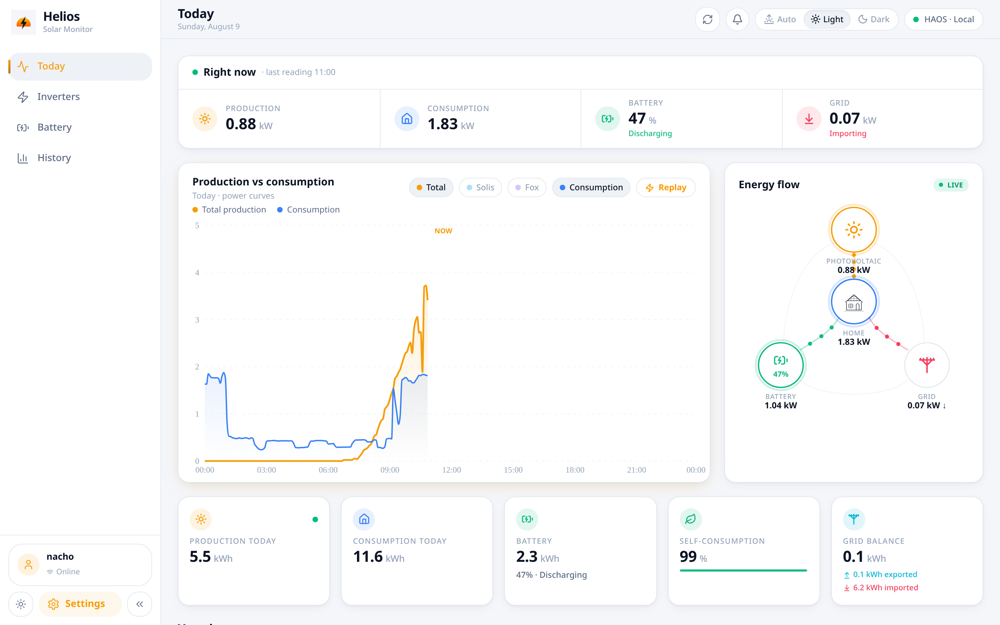
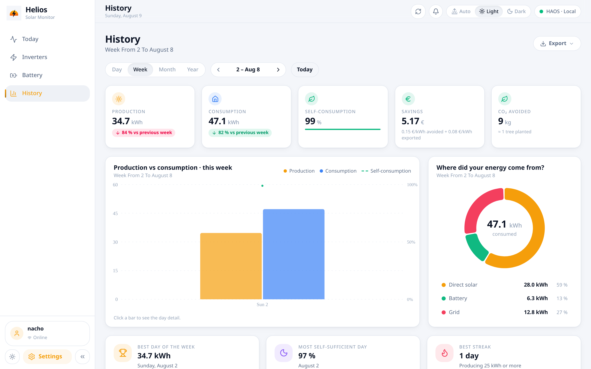
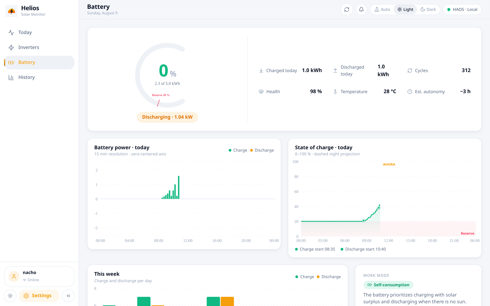

# Helios

<p align="center">
  <a href="README.md">English</a> |
  <a href="README.es.md">Español</a>
</p>

<p align="center">
  <a href="https://helios.cloudless.club"></a>
  <a href="https://demo.helios.cloudless.club"></a>
  <a href="https://github.com/gnacho/helios/releases"></a>
  <a href="https://github.com/gnacho/helios/actions/workflows/release.yml"></a>
  <a href="LICENSE"></a>
  <a href="https://ko-fi.com/gnacho"></a>
</p>

<p align="center">
  <picture>
    <source media="(prefers-color-scheme: dark)" srcset="assets/hero-en-dark.png">
    <source media="(prefers-color-scheme: light)" srcset="assets/hero-en-light.png">
    
  </picture>
</p>

Helios is a solar monitor you host yourself. It reads the energy sensors your
Home Assistant already has, over the WebSocket API, and turns them into three
things: a live panel, a long history, and the money your installation saves
against the tariff you actually pay.

One static Go binary with SQLite inside. No cloud account, no vendor app and no
client JavaScript bundle.

- **Your data stays at home.** The database is a file on your machine, with a
  continuous replica you control.
- **Live readings.** The panel moves with the sensors, at the pace your
  integration publishes them.
- **Any hardware Home Assistant can see.** Inverters, battery, grid meter and
  EV chargers.
- **Savings in euros.** Self-consumption and savings computed against the price
  you actually pay.

> **Try the live demo**
>
> See it running without installing anything: **[demo.helios.cloudless.club](https://demo.helios.cloudless.club)**.
> A sample installation with realistic solar data, no sign-up, read-only.

## What it does

**Live panel.** Production and consumption curves, the energy flow diagram, and
today's totals: what the panels made, what the house used, what went to the
battery and what crossed the meter. Everything updates over SSE while the page
is open, and the charts redraw themselves every minute without a reload.

**History that survives.** Daily aggregates per inverter, per charger and for
the whole installation: production, consumption, grid import and export,
battery charge and discharge, self-consumption ratio, savings and CO₂ avoided.
You can navigate by week, month or year, and the data is a SQLite file you can
copy, inspect or move to another machine whenever you want.

**Your battery.** State of charge, charge and discharge flows, and how much of
the day went through it.

**EV chargers.** One card per charger, with current power, the amps you have
selected and a schedule. It works with wall boxes and with portable chargers
that only appear in Home Assistant while they are plugged in.

**Multi-user with roles.** Admin and regular users, httpOnly cookies, bcrypt,
login rate limiting and an audit log. Admin recovery is deliberately limited to
requests from localhost.

**Three languages.** English, Spanish and Chinese, chosen per user and stored
in the database.

**A PWA.** Installable, with light, dark and automatic themes. The automatic
one follows the solar hour, not the operating system.

## Works with any installation

Helios talks to Home Assistant rather than to your hardware, so anything HAOS
can expose is fair game:

- **Any number of inverters.** Each one with its own name, peak power and
  sensors.
- **Any number of EV chargers.** Wall box or portable, through a switch, a
  power sensor and a current selector.
- **One battery.** The topology describes a single battery bank, with its power
  and state-of-charge sensors. Supporting several is tracked in
  [#197](https://github.com/gnacho/helios/issues/197).

My own installation, as an example rather than a requirement: two inverters
from different brands, one battery, and two EV chargers, the second one a
portable unit that is only in Home Assistant while it is plugged in. Nothing in
the code is tied to those brands.

If a device has no local integration, a scraper can feed Home Assistant and
Helios will read it like any other sensor. Helios does not care where the
number came from, only that it is in HAOS.

## Screenshots

Real usage, from the production installation:

**History: weekly aggregates, savings and CO₂**

<picture>
  <source media="(prefers-color-scheme: dark)" srcset="assets/screenshot-history-en-dark.png">
  <source media="(prefers-color-scheme: light)" srcset="assets/screenshot-history-en-light.png">
  
</picture>

**Battery: charge state and flows**

<picture>
  <source media="(prefers-color-scheme: dark)" srcset="assets/screenshot-battery-en-dark.png">
  <source media="(prefers-color-scheme: light)" srcset="assets/screenshot-battery-en-light.png">
  
</picture>

There is no demo dataset behind these: it is real data, which explains better
what each view is for.

## How it works

```
inverters · battery · meter · chargers
                 │
                 ▼
          Home Assistant  ──WebSocket──▶  Helios (Go)
                 ▲                          │
        optional scraper                    ▼
        (feeds HAOS)                    SQLite file
                                            │
                                        Litestream
                                            ▼
                                   backup you control
```

Home Assistant does the hard part: it talks to the hardware and keeps the
connections alive. Helios subscribes to those entities, aggregates and
sanitises the readings, and serves the API and the UI from the same binary.

Server-rendered HTML with a small amount of Datastar on top, so there is no
client bundle to build or invalidate. The whole thing is one Go process next to
its database.

The reasoning behind each piece is in [STACK.md](STACK.md) and
[ARCHITECTURE.md](ARCHITECTURE.md).

## Install

Helios needs a Home Assistant with the energy sensors already working, and a
long-lived access token (Profile → Security → Long-lived access tokens).

```bash
git clone https://github.com/gnacho/helios.git
cd helios
make build            # templ + Tailwind + Go, no Node
./helios-go           # export HAOS_URL, HAOS_TOKEN and SESSION_SECRET first
```

Then open the app and let an admin configure the topology from Settings: which
entities are your inverters, your battery, your grid source and your chargers.
No JSON needed, though the API accepts it if you prefer.

- **Configuration in detail**, including every environment variable and the
  full topology object: [docs/configuration.md](docs/configuration.md).
- **Running it for real**, systemd unit, backups, updates and admin recovery:
  [docs/operations.md](docs/operations.md).

## Roadmap

| Phase | Focus | Status |
|---|---|---|
| 1 | Live read-only panel (production vs consumption) | Done |
| 2 | Real backend, multi-user, history, battery, alerts, PWA, hardening | Done (~0.6.x) |
| 3 | Configurable hardware (still under HAOS) | Done (0.7.x) |
| 4 | Multi-installation: several HAOS or several Helios via API | Up next |

Detail in [ROADMAP.md](ROADMAP.md). Several batteries per installation is
tracked separately in [#197](https://github.com/gnacho/helios/issues/197).

## Big thanks

Helios would not exist without [Home Assistant](https://www.home-assistant.io/).
It already does the difficult part: talking to the hardware, handling
reconnections and exposing clean sensors. Helios just reads what HAOS already
collects. If this project is useful to you, the real credit goes to the people
who keep Home Assistant running.

## License

AGPL-3.0, see [LICENSE](LICENSE).
